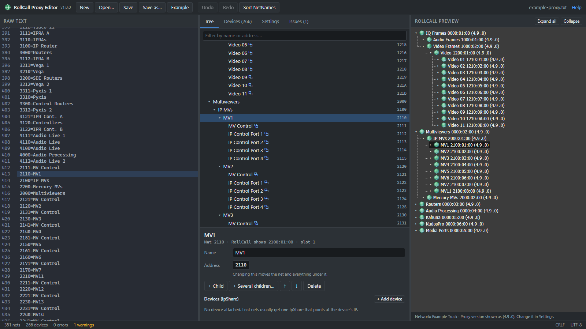

# RollCall Proxy Editor

Edit RollCall proxy configuration files without fighting the text format.

**[Open the app →](https://nickpoopy.github.io/RollCall-Proxy-Editor/)** · or download the single-file offline version from [Releases](https://github.com/NickPoopy/RollCall-Proxy-Editor/releases) (works with no internet, just open the `.html` in Chrome or Edge).



The window has three panes, all kept in sync:

| Raw text | Editor | RollCall preview |
|---|---|---|
| The actual file. Paste, type, or open one. Errors and warnings are marked in the gutter. | A friendly tree with forms for names, addresses and devices, plus tables for all devices and settings. | A mock-up of the tree RollCall will show, using the same `Name NNNN:DD:00 (version)` labels. |

Click a net in any pane and it's highlighted in the other two.

## Features

- **Open / Save** proxy files. In Chrome and Edge, Save writes back to the same file. Line endings (CRLF) and encoding are preserved, and untouched lines come out byte-for-byte identical.
- **Add, rename, move, reorder and delete** nets. Addresses are picked automatically (next free slot), and moving a net moves everything under it.
- **Bulk add**: create e.g. 10 children named `Video {n:2}` with device IPs counting up from `10.0.0.10`.
- **Duplicate…**: stamp out copies of a whole branch (e.g. MV1 → MV2–MV7) with every child and device. Names are renamed with find → replace rules (`MV1` → `MV{n}`), and every IP shifts by a step per copy (e.g. +10 on the last octet).
- **Paste outline…**: build a whole tree in one go from an indented outline or a paste from Excel (see below). **Copy branch as outline** exports a branch the same way, so you can edit it in Excel and paste it back.
- **Devices table**: edit every `IpShare` line in one grid, with filtering.
- **Settings**: edit the other sections (`[Combiner Services]`, `[MonitoringToLogServer]`, …) as key/value pairs.
- **Validation**: duplicate addresses, unnamed parents, bad IPs/ports, more than 15 children, duplicate IP:port.
- **Undo / redo**, plus a draft autosave in the browser so a closed tab doesn't lose work.
- Everything runs locally in your browser. Files are never uploaded anywhere.

## How the proxy file maps to the tree

```
[NetNames]
1000=IQ Frames        ->  IQ Frames      0000:01:00
1200=Video Frames     ->    Video Frames 1000:02:00
1210=Video            ->      Video      1200:01:00
1211=Video 01         ->        Video 01 1210:01:00
```

- Net addresses are **4 hex digits**, one digit per tree level. `0` means "level not used", so a net can have up to 15 children (1–F), and the tree is at most 4 levels deep. `0000` is the root/system name.
- RollCall shows each net as `parent:DD:00`, where `DD` is the net's own digit.
- `IpShareN=ip1,port1,NET,ip2,port2,ip3,port3,` in `[Combiner Services]` attaches the device at those IP addresses to net `NET`. `-` means an address slot is unused. RollCall then shows the device (with its own name, address and version) under that net. The preview shows a placeholder row for it, because the real details come from the device.

## Outline format (Paste outline…)

One net per line. Indentation sets the level: Tab, spaces, or Excel columns A, B, C… (empty leading cells paste as tabs). Addresses go after the name, either in the next cells/tabs or after `@` separated by commas. Each is `ip` or `ip:port`, and `-` marks an unused slot.

```
Replay
	EVS
		EVS 1	10.30.1.11	10.31.1.11
		EVS 2 @ 10.30.1.12:2051, 10.31.1.12
Routers
	Spare Router	10.30.2.1
```

With "Reuse existing nets with the same name" on, `Routers` above goes into the existing Routers net instead of creating a second one. The preview shows which rows are new and which already exist before anything is changed.

## Development

```bash
npm install
npm run dev            # http://localhost:5173
npm test               # parser / model tests
npm run build          # web build -> dist/
npm run build:offline  # single self-contained HTML -> dist-offline/index.html
```

Stack: React + TypeScript + Vite, Zustand, CodeMirror 6, Vitest.

```
src/model/    file format: parse, serialize, address math, tree, validation, edit operations (pure, unit-tested)
src/state/    app store (undo, selection, autosave), file open/save, templates
src/panes/    RawTextPane, EditorPane (+ editor/*), PreviewPane
```

`samples/example-proxy.txt` is an anonymized real proxy file, used by the tests and the **Example** button. Put real files in `samples/private/` (git-ignored). The tests also check that they round-trip.

## Releasing

Bump `version` in `package.json`, update `RELEASE_NOTES.md`, then push a tag:

```bash
git tag v1.0.1 && git push origin v1.0.1
```

GitHub Actions runs the tests and publishes a release with the offline HTML attached. Every push to `main` redeploys the web app to GitHub Pages.
